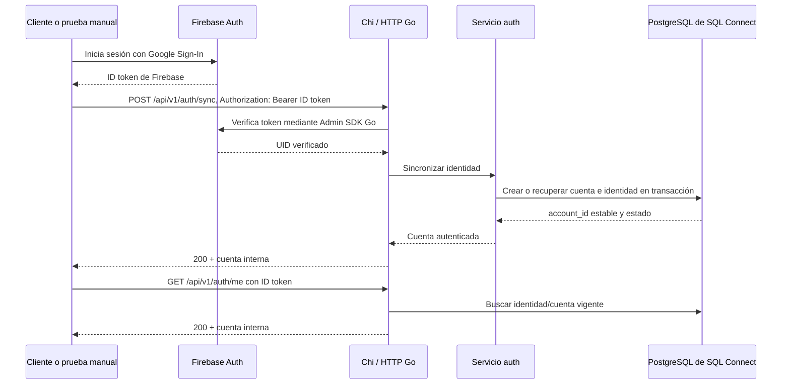

# 01 — Autenticación Firebase y cuenta interna en Go

Fecha de creación: 2026-09-29  
Última actualización: 2026-09-29  
Estado: Primera etapa de backend implementada; integración real con Firebase y Cloud SQL pendiente de credenciales  
Ámbito: `navigate-business-api`, únicamente autenticación y persistencia de identidad  
Revisión de referencia: sin revisión Git disponible en esta carpeta al redactar el plan  
Relacionada con: [producto: autenticación](../../../docs/product/09-autenticacion-pagos-y-decisiones-abiertas.md), [producto: cuenta única](../../../docs/product/03-identidad-roles-y-tiendas.md), [arquitectura Go](../fonts/go-backend/arquitectura/01-tiago-arquitectura-y-repositorios.md), [auth Go](../fonts/go-backend/autenticacion-autorizacion/01-tiago-autenticacion-y-autorizacion.md), [persistencia](../fonts/go-backend/persistencia-seguridad/01-transacciones-y-seguridad-de-datos.md), [bitácora 03](../../bitacora-construccion/auth/03-modulo-auth-y-migraciones-estandar.md) y [README](../../README.md).

## Objetivo y alcance exacto

Una persona inicia sesión **en Firebase Authentication** y presenta su *ID token* a la API Go. La API verifica el token, crea o recupera de forma idempotente una cuenta interna mediante SQL directo sobre la base PostgreSQL alojada por Firebase SQL Connect y devuelve el `account_id` estable. La misma cuenta servirá después para los espacios de comprador y tienda. «Un solo usuario» se interpreta como **una cuenta por persona**, no como un límite de una cuenta para toda la plataforma [P1, P2].

Este incremento termina cuando una identidad real de Firebase puede llamar a `POST /api/v1/auth/sync` y `GET /api/v1/auth/me`, obtener siempre la misma cuenta interna y ser rechazada si el token es inválido o la cuenta está suspendida. No habrá endpoint Go que reciba contraseñas, emita JWT propios o determine roles.

El cliente Expo/web, tiendas, membresías, permisos, pagos y migración de usuarios anteriores quedan fuera de esta etapa. **Google Sign-In es el único método aceptado:** la persona usará el botón de Google en una etapa posterior del cliente, Firebase Authentication emitirá su ID token y Go verificará `firebase.sign_in_provider = google.com`. No se habilitará correo/contraseña ni se administrarán contraseñas en Go. El backend requiere el **ID token de Firebase**, no el token OAuth de Google [O1, O2, O14].

## Punto de partida y decisión de proveedor

- Al redactar este plan, el código contenía `cmd/api/main.go`, `internal/httpapi/router.go` con Chi y una ruta pública `GET /api/v1/hello-world`; aún no había capa auth, conexión SQL ni migraciones. El `go.mod` declaraba Go 1.26.4 y no se encontró repositorio Git en la raíz de este backend. La implementación y el repositorio Git se crearon después; ver la [bitácora 03](../../bitacora-construccion/auth/03-modulo-auth-y-migraciones-estandar.md). [C1]
- Los documentos de producto son un borrador; las referencias de auth ya señalan el backend Go actual. Se conserva la separación entre identidad del proveedor y cuenta de negocio [P1, P2, C1].
- La imagen aportada muestra **Firebase SQL Connect**, respaldado por Cloud SQL para PostgreSQL. La documentación de Firebase permite acceso directo a esa base y mantener migraciones SQL propias. Esa es la decisión actual: Go consultará PostgreSQL con `pgx`; no usará la API GraphQL de SQL Connect para auth [O3, O5].
- Firebase documenta Admin SDK Go para verificar tokens. La aplicación usará `pgx` y el conector/proxy de Cloud SQL para SQL directo; SQL Connect queda como servicio que proporciona la base, no como API de consultas del backend [O1, O5, O9].

### Un solo dueño de cada responsabilidad

| Responsabilidad | Dueño propuesto | Regla |
| --- | --- | --- |
| Inicio con Google y renovación | Firebase Authentication y SDK del cliente | Solo proveedor Google habilitado; Go no guarda contraseñas ni refresh tokens. |
| Validación de identidad | Adaptador Firebase Admin SDK en Go | Obtener UID solo de un ID token verificado. |
| Cuenta y estado propios | Servicio `auth` + repositorio PostgreSQL | `account_id` independiente del UID. |
| Esquema de auth | Migraciones SQL versionadas del proyecto | Única fuente de DDL de esas tablas. |
| Acceso a filas | Repositorio Go con `pgx` | Consultas parametrizadas y transacciones. |
| Futuras tiendas/roles | Incrementos posteriores | No inferir permisos del token ni crearlos ahora. |

En `firebase dataconnect:sql:setup` se elegirá **conservar la propiedad de las migraciones SQL** y no delegarlas a SQL Connect. Firebase documenta esta ruta para bases cuyo esquema gestiona el equipo: SQL Connect obtiene lectura/escritura, mientras la aplicación mantiene propiedad del esquema y sus migraciones. Se verificará el efecto real de esa configuración en el proyecto de desarrollo antes de desplegar; no se aplicarán migraciones con `firebase dataconnect:sql:migrate` sobre las mismas tablas [O5].

## Flujo que deberá quedar implementado

Firebase entrega un **ID token** al cliente después del inicio con Google; el cliente lo envía por HTTPS en `Authorization: Bearer ...`. El backend nunca confiará en un UID, correo o `account_id` enviados en el cuerpo o cabeceras como prueba de identidad. Se usa `VerifyIDTokenAndCheckRevoked` del Admin SDK Go y se exige `firebase.sign_in_provider = google.com`; la comprobación de revocación añade una consulta de red a Firebase y se medirá antes de ampliarla a toda la API [O1, O2, O14]. Si la verificación falla, no habrá sincronización ni creación de filas. El estado interno `suspended` se consulta en la base en cada ruta protegida, para que una suspensión de la aplicación surta efecto sin esperar a que venza un token [P1, O2].

`POST /api/v1/auth/sync` es explícitamente idempotente: el primer llamado crea la cuenta; los siguientes recuperan el mismo `account_id`. Se usa POST porque puede escribir. `GET /api/v1/auth/me` no crea nada: consulta la cuenta ya sincronizada. El cierre de sesión y la renovación del token pertenecen al SDK del cliente; la API Go no necesita una tabla de sesiones para este incremento [O2].

## Modelo de datos y migración propuesta

Las tablas de auth se definirán **solo** en `migrations/000001_auth.up.sql` y su reversa `migrations/000001_auth.down.sql`, con un ejecutor de migraciones separado del servidor HTTP. No habrá definición `.gql` que actúe como segundo dueño del DDL. Modelo lógico previsto:

| Tabla | Columnas mínimas | Restricciones |
| --- | --- | --- |
| `accounts` | `id UUID`, `status` (`active`/`suspended`), `created_at`, `updated_at` | `id` PK; estado no nulo. Sin roles ni perfil comercial. |
| `auth_identities` | `id UUID`, `account_id UUID`, `provider` (`firebase`), `provider_subject` (UID), `created_at` | `id` PK; FK a `accounts`; `UNIQUE(provider, provider_subject)`; `account_id` no nulo. |

La separación evita usar el UID de Firebase como PK de la aplicación. No habilita vinculación automática: una identidad Firebase crea una cuenta. El correo no identifica ni fusiona cuentas. Si se elimina una identidad en Firebase, las filas internas no se borran automáticamente; la política de baja queda para una decisión posterior [P1, P2].

`Sync` iniciará una transacción SQL para insertar cuenta e identidad. Si dos primeras peticiones compiten, la restricción única provoca que una transacción revierta; entonces se consulta la cuenta existente y se devuelve su mismo `account_id`. No queda una cuenta huérfana. Se usarán parámetros SQL, tiempos de espera y un pool pequeño; nunca se interpolará el UID en una consulta [F3, R3].

**Secuencia para aplicar la migración preparada en un proyecto Firebase real:**

1. Crear/configurar Firebase SQL Connect y su instancia Cloud SQL de desarrollo. En `firebase dataconnect:sql:setup`, rechazar que SQL Connect gestione migraciones SQL; separar permisos de propietario de esquema y runtime [O5].
2. Revisar las migraciones SQL numeradas `up`/`down` e invocar `make migrate-up` con `golang-migrate` y la identidad SQL propietaria **antes** de iniciar la API. El proceso HTTP no migra al arrancar.
3. Probar migración desde cero, repetición sin cambios y reversión en desarrollo. Si se utiliza también un esquema `.gql` de SQL Connect, mantenerlo compatible con la estructura SQL ya migrada y comprobar el diff para asegurar que su despliegue no propone DDL sobre estas tablas [O4, O5].
4. Conceder al proceso Go el rol SQL `writer` sobre el esquema necesario y `roles/cloudsql.client`; si se usa autenticación IAM automática, añadir `roles/cloudsql.instanceUser`. La identidad de migración tendrá permisos de owner separados. No usar superuser para atender peticiones [O5, O9].

Antes de crear la instancia, revisar región, facturación y presupuesto: SQL Connect y Cloud SQL son componentes facturables distintos [O13]. En este incremento no se publicarán conectores GraphQL para clientes sobre las tablas de cuenta.

## Diseño Go propuesto, archivo por archivo

Archivos de la primera etapa implementada:

| Archivo | Responsabilidad concreta |
| --- | --- |
| `internal/auth/account.go` | Tipo de cuenta y estado; identidad autenticada independiente de Firebase/HTTP. |
| `internal/auth/service.go` | `Sync(ctx, uid)` y `Current(ctx, uid)`; puerto `Repository` y regla de suspensión. |
| `internal/auth/firebase/verifier.go` | Adaptador del Admin SDK: verificar ID token, comprobar revocación y devolver UID verificado. |
| `internal/auth/postgres/account_repository.go` | Consultas SQL parametrizadas, transacción e interpretación de conflictos; ninguna decisión HTTP. |
| `internal/auth/http/middleware.go` | Bearer, verificación y UID en contexto para todas las rutas del grupo protegido. |
| `internal/auth/http/handler.go` | Respuestas `/auth/sync`, `/auth/me` y errores HTTP de cuenta. |
| `internal/httpapi/router.go` | Montar rutas auth con Chi y límite de tiempo. |
| `cmd/api/main.go` | Leer configuración, inicializar Firebase Admin y `pgxpool`, inyectar dependencias y cerrar el pool. |
| `migrations/000001_auth.{up,down}.sql` | Declarar y revertir el esquema de identidad con SQL propio. |
| `Makefile` | Exponer `migrate-up` y `migrate-down` con la CLI versionada de `golang-migrate`; el motor conserva el registro de versión. |

Dirección de dependencias: `httpapi/router → auth/http → auth.Service → auth.Repository`; `auth/firebase` verifica identidad en el borde, `auth/postgres` implementa el puerto y `main` conecta las piezas. Chi queda en HTTP; Firebase y `pgx` no entran en `auth/service.go`. Los subpaquetes agrupan adaptadores de la funcionalidad sin convertir el núcleo en dependiente de ellos. Esto adapta la separación enseñada por Tiago, sin copiar su JWT HMAC ni sus tablas de roles [F1, R1, F2, R2]. No se crearán interfaces por cada struct: solo el verificador externo y el repositorio usados por el servicio/HTTP.

Go accederá directamente al PostgreSQL asociado a SQL Connect mediante `pgxpool`, con el conector de Cloud SQL o Auth Proxy según el entorno; no llamará a `executeGraphql`, conectores GraphQL ni SDK de datos de SQL Connect. La documentación oficial permite este acceso directo con rol SQL y `roles/cloudsql.client` [O5, O9].

Configuración implementada: `FIREBASE_PROJECT_ID`, credenciales ADC, `DATABASE_URL` PostgreSQL que apunte al proxy/conector Cloud SQL, pool máximo de cinco conexiones y timeout HTTP de ocho segundos. `FIREBASE_AUTH_EMULATOR_HOST` se permite solo con `APP_ENV=development`; el emulador acepta tokens de prueba sin firma [O11, O12]. Las credenciales y URI con secretos quedan fuera de Git. Si Firebase o SQL fallan, la API no autoriza por omisión. La configuración concreta de la instancia y permisos IAM/SQL se hará al disponer del proyecto Firebase [O5, O9].

## Contrato HTTP y errores

| Petición | Resultado esperado |
| --- | --- |
| `POST /api/v1/auth/sync` con ID token válido nuevo | `201 Created`, `{ "account_id": "<uuid>", "status": "active" }`. |
| Mismo POST repetido, incluso concurrente | `200 OK`, mismo `account_id`, una sola cuenta/identidad. |
| `GET /api/v1/auth/me` tras sincronizar | `200 OK`, mismo `account_id` y estado. |
| Token ausente, mal formado, vencido, de otro proyecto o revocado | `401 Unauthorized`, mensaje genérico, sin crear cuenta. |
| Cuenta `suspended` | `403 Forbidden`, sin acceso a la cuenta aunque el ID token siga siendo válido. |
| `GET /auth/me` válido antes de `/auth/sync` | `404 Not Found` con código de aplicación `account_not_synced` para permitir al cliente ejecutar la sincronización. |
| Firebase o SQL indisponible | `503 Service Unavailable`; sin crear identidad ficticia ni revelar datos de infraestructura. |

Las rutas protegidas futuras usarán el mismo mecanismo de verificación y recuperación de cuenta, pero sus permisos específicos se diseñarán con las entidades de tienda. No se colocará un rol global en el token de Firebase ni se creará una tabla de roles ahora [P2, F1]. Si se exponen datos de perfil más adelante, se añadirá un contrato versionado; este JSON mínimo evita publicar UID y correo innecesariamente.

## Incrementos de implementación y comprobación prevista

1. **Esquema y conexión.** Migraciones y repositorio `pgx` escritos. Pendiente aplicar la migración y probar transacciones y concurrencia en la instancia de desarrollo de SQL Connect.
2. **Verificación Firebase.** Admin SDK Go integrado con revisión de revocación y proveedor `google.com`. Prueba local de la regla de proveedor ejecutada; tokens reales, expirados, de otro proyecto, revocados y usuarios deshabilitados quedan pendientes de un proyecto Firebase configurado [O1, O2, O11].
3. **Sincronización y lectura.** Servicio y handlers implementados; pruebas HTTP con dobles ejecutadas para primera llamada, repetición, lectura, suspensión y errores de verificación. Pendiente petición HTTP real con token y base de desarrollo. `go test ./...` y `go vet ./...` ejecutados; detalles en la [bitácora](../../bitacora-construccion/auth/01-google-firebase-y-cuenta-sql.md).
4. **Preparación de despliegue.** Variables y orden de migración documentados en el README. La configuración concreta de IAM/SQL se completará al vincular la instancia Firebase.

**Criterio de cierre de integración pendiente:** dos peticiones reales autenticadas de la misma persona devuelven un único `account_id`; ninguna petición sin identidad válida crea filas; una suspensión local corta el acceso; la migración se aplica y revierte en desarrollo. El código de esta etapa está preparado, pero no se afirma ese cierre sin proyecto Firebase y SQL configurados.

## Decisiones explícitas para revisar antes de implementar

1. **Método de inicio del primer cliente: decidido.** Google Sign-In mediante Firebase Authentication; correo/contraseña queda deshabilitado. Esta etapa implementa solo Go. El futuro botón en Expo entregará un ID token de Firebase a estas rutas; no se modifica Expo ahora.
2. **SQL directo con migraciones propias:** decisión confirmada por el usuario. SQL Connect proporciona la instancia PostgreSQL; Go accede con `pgx` y el proyecto conserva sus migraciones SQL. No se usará GraphQL para este flujo ni se delegará el DDL a la CLI de SQL Connect.
3. **Política de revocación:** se propone comprobarla en cada petición auth, aceptando el coste de una llamada adicional a Firebase. Se medirá latencia y disponibilidad antes de aplicarla a todas las rutas futuras.
4. **Identidades vinculadas:** una cuenta admite conceptualmente otra identidad en el modelo, pero no hay endpoint de vinculación automática. Evitar fusionar por correo; diseñar el flujo explícito cuando exista la necesidad.

## Fuentes y procedencia de decisiones

Consultadas el 2026-09-29. Los enlaces oficiales fundamentan las capacidades actuales del proveedor; los documentos locales expresan producto o material de curso. Las elecciones de tablas, rutas y política de errores son **adaptaciones de este proyecto**, no instrucciones del curso. La [ficha de fuentes oficiales](../fonts/firebase/01-google-auth-admin-y-sql-connect.md) conserva la investigación de proveedor.

| ID | Fuente y pasaje recuperable | Qué respalda / límite |
| --- | --- | --- |
| P1 | [Producto: autenticación](../../../docs/product/09-autenticacion-pagos-y-decisiones-abiertas.md), secciones «Autenticación: objetivo» y «Contrato interno de identidad» | Separar proveedor y cuenta; actualización vigente para API Go y SQL Connect. |
| P2 | [Producto: identidad](../../../docs/product/03-identidad-roles-y-tiendas.md), «Decisión principal» y «Reglas de autorización» | Cuenta única y permisos posteriores por tienda. |
| C1 | [README](../../README.md), [router](../../internal/httpapi/router.go) y [main](../../cmd/api/main.go) | Estado real de Go/Chi antes de esta implementación. |
| F1 / R1 | [Original 67. Validating Tokens](../reconstrucciones-cursos-go/APIs%20de%20Producción%20con%20Go/Sección%2014%20Authentication/67.%20Validating%20Tokens.md), líneas 13–47; [reconstrucción: `TokenAuth`](../reconstrucciones-cursos-go/APIs%20de%20Producción%20con%20Go/Sección%2014%20Authentication/67.%20Validating%20Tokens%20-%20Reconstrucción%20guiada.md) | Middleware, usuario en contexto y separación posterior de autorización. El ejemplo usa JWT propio; aquí se sustituye por Admin SDK Firebase. |
| F2 / R2 | [Original 29. The Repository Pattern](../reconstrucciones-cursos-go/APIs%20de%20Producción%20con%20Go/Sección%206%20Databases/29.%20The%20Repository%20Pattern.md), líneas 13–39; [reconstrucción: `Store`](../reconstrucciones-cursos-go/APIs%20de%20Producción%20con%20Go/Sección%206%20Databases/29.%20The%20Repository%20Pattern%20-%20Reconstrucción%20guiada.md) | Separar contrato de persistencia y SQL concreto. |
| F3 / R3 | [Original 58. SQL Transactions](../reconstrucciones-cursos-go/APIs%20de%20Producción%20con%20Go/Sección%2012%20User%20Creation/58.%20SQL%20Transactions.md), líneas 13–43; [reconstrucción: transacción](../reconstrucciones-cursos-go/APIs%20de%20Producción%20con%20Go/Sección%2012%20User%20Creation/58.%20SQL%20Transactions%20-%20Reconstrucción%20guiada.md) | Operaciones relacionadas atómicas; no se copian invitaciones ni roles del curso. |
| O1 | [Firebase: Verify ID Tokens](https://firebase.google.com/docs/auth/admin/verify-id-tokens), secciones «Retrieve ID tokens» y «Go» | Enviar ID token al backend, `VerifyIDToken`, UID y validación de proyecto. |
| O2 | [Firebase: Manage User Sessions](https://firebase.google.com/docs/auth/admin/manage-sessions), «Detect ID token revocation» y ejemplo Go | `VerifyIDTokenAndCheckRevoked`, duración de ID tokens y coste de comprobación. |
| O3 | [Firebase: SQL Connect](https://firebase.google.com/docs/sql-connect), «How does it work?» | Cloud SQL PostgreSQL, esquema GraphQL, operaciones y plataformas SDK. |
| O4 | [Firebase: Deploy and manage schemas and connectors](https://firebase.google.com/docs/sql-connect/manage-schemas-and-connectors), «Migrate database schemas» | `diff`, `migrate`, modos compatible/strict y cambios destructivos. |
| O5 | [Firebase: referencia CLI SQL Connect](https://firebase.google.com/docs/sql-connect/cli-reference), `dataconnect:sql:setup` y `dataconnect:sql:grant` | Permite conservar migraciones propias y conceder acceso directo a la base. |
| O6 | [Firebase: Configuration file reference](https://firebase.google.com/docs/sql-connect/configuration-reference), `dataconnect.yaml` | Configuración y efecto de `schemaValidation`. |
| O9 | [Google Cloud: conectar Cloud Run con Cloud SQL](https://docs.cloud.google.com/sql/docs/postgres/connect-run), sección Go; [Cloud SQL desde GKE](https://docs.cloud.google.com/sql/docs/postgres/connect-kubernetes-engine), autenticación IAM | Opciones de conexión Go, límites de conexiones y rol `roles/cloudsql.instanceUser` para IAM automática. |
| O11 | [Firebase: Authentication Emulator](https://firebase.google.com/docs/emulator-suite/connect_auth), «Admin SDKs» | `FIREBASE_AUTH_EMULATOR_HOST` y aceptación local de tokens sin firma. |
| O12 | [Firebase: Admin SDK setup](https://firebase.google.com/docs/admin/setup), «Go» y «Initialize the SDK» | SDK Go, ADC y configuración de project ID. |
| O13 | [Firebase: SQL Connect pricing](https://firebase.google.com/docs/sql-connect/pricing), «Understand SQL Connect billing» | SQL Connect y su infraestructura subyacente tienen componentes de facturación distintos. |
| O14 | [Firebase: Authenticate Using Google with JavaScript](https://firebase.google.com/docs/auth/web/google-signin), «Before you begin» y «Handle the sign-in flow»; [Admin Go `FirebaseInfo`](https://pkg.go.dev/firebase.google.com/go/v4/auth#FirebaseInfo) | Google es proveedor configurable; el ID token de Firebase incluye el proveedor de la sesión, que Go puede exigir como `google.com`. |
